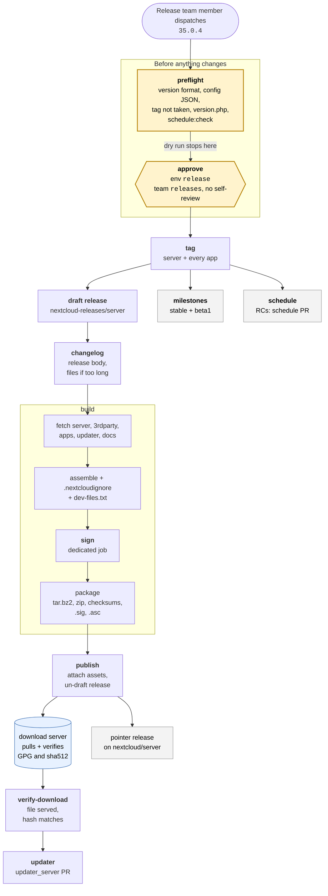

# Nextcloud Server Releases

Release artifacts and automation for Nextcloud server. Branches are synced daily
from `nextcloud/server`.

> [!IMPORTANT]
> This pipeline does not publish releases yet. The legacy release script still
> does that, and this runs alongside it to prove it would produce the same
> result. See [Migration status](#migration-status).

## Triggering a release

A release is fully determined by its tag (`vMAJOR.MINOR.PATCH[suffix]`). From
the tag alone, `release.yml` derives the release branch, the repository set, the
milestone actions, and the release channel. There is no per-release
configuration beyond the tag and the per-major app list:

- a `.0.0` **alpha or beta of a new major** comes from `master`, using
  `master.json`
- **everything else**, stable releases and candidates, comes from `stableN`,
  using `stableN.json`

> [!NOTE]
> Nobody starts the pipeline by hand. The legacy release script dispatches
> `release.yml` with the tag. Individual workflows can be re-run for recovery,
> see [Running a workflow by hand](#running-a-workflow-by-hand).

## The pipeline

`Tag -> Changelog -> Build -> Updater` is a linear chain; Milestones and Schedule
branch off Tag and run in parallel with it. A failed job blocks its dependents,
so the pipeline cannot publish a partial release.

<b>What each of the six workflows does</b>

| Workflow | What it does | After | Only for |
| --- | --- | --- | --- |
| `release-tag.yml` | Tags every repository in the release set at the tip of the resolved branch, via the git-refs API (no clone). Server repositories are never re-tagged. | | all |
| `release-changelog.yml` | Resolves the previous tag, generates the changelog for that range, attaches it to the GitHub release. | Tag | all |
| `release-build.yml` | Fetches each component, assembles the `nextcloud/` tree, strips dev files, rewrites `version.php`, signs, and produces the `.tar.bz2`/`.zip` plus checksums. Also diffs its output against the legacy script. | Changelog | all |
| `release-updater.yml` | Applies the release to a checkout of the updater server (`releases.json`, `major_versions.json`, Behat features), regenerates config via `make`, opens a pull request. | Build | all |
| `release-milestones.yml` | Updates and audits milestones across the release set. See [Milestones](#milestones). | Tag | stable releases and first betas |
| `release-schedule.yml` | Keeps `release-schedule.json` ahead of the releases that read it. See [Release schedule](#release-schedule). | Tag | candidates |

Tag, Milestones, Schedule, and Updater are PHP commands in
[`tools/release/`](tools/release/README.md) with unit, snapshot, and byte-parity
tests. Build, package, and sign are bash in
[`.github/scripts/`](.github/scripts/README.md) with hermetic snapshot and unit
tests. Both suites run on every push to `main` and every pull request.

## Before a release

> [!WARNING]
> A stable release **stops before anything is tagged** while the
> release-schedule pull request is open, or while its next patch milestone has
> no due date in `release-schedule.json` (unless it is the last release of its
> series). Pre-releases are never stopped. Run the check yourself with
> `php tools/release/bin/console schedule:check vX.Y.Z release-schedule.json`.

1. **The open release-schedule pull request is merged.** The candidate a week
   earlier opened one with the dates this release needs, so merging it is
   normally all this takes. If there is no such pull request, check that
   `release-schedule.json` has an entry for the next patch milestone and add
   one following the [cadence](#cadence) if it does not. See
   [Release schedule](#release-schedule).
2. **The major has a config JSON**: `stableN.json` for stable releases and
   candidates, `master.json` for a new major's alpha or beta. It must list every
   bundled app.
3. **The version bump is merged on server.** `version.php` on the target branch
   must already state the version being released, so the tag and `version.php`
   agree.

## Configuration

| File | Purpose |
| --- | --- |
| `stableN.json`, `master.json` | The apps bundled in a release, one file per major. Edit when an app joins or leaves the release. |
| `tag-only.json` | Repositories tagged on release but not part of the build: server, 3rdparty, updater, example-files, documentation. |
| `release-schedule.json` | Milestone due dates, as `"Nextcloud 34.0.1": "2026-06-25"`. |

## Release schedule

`release-schedule.json` gives the milestones step its due dates. Only two
entries per maintained major matter, the next patch and the one after: the next
one is required, the one after is optional and its milestone is created without
a date when it is absent.

> [!TIP]
> You should not normally edit this file by hand. Every release candidate runs
> [`release-schedule.yml`](.github/workflows/release-schedule.yml), which opens a
> pull request with the dates the stable release will need a week later and drops
> entries for rounds that have shipped. A weekly run catches anything a skipped
> candidate missed. A date you correct by hand is never overwritten.

### Cadence

A round is a Thursday, at most one per calendar month, four weeks after the
previous one, stretched to five when four weeks would land twice in the same
month. Majors are maintained for 12 months from their release, so a series ends
with the last round inside that window.

> [!IMPORTANT]
> The wiki release schedule wins, and the pull request above is computed rather
> than read from it. Check its dates against the wiki before merging. The cadence
> is only for dates the wiki has not published yet.

<b>Worked example: the cadence applied to 33 and 34</b>

**This is an illustration, not a schedule to work from.** It applies the rule to
the two majors that happened to be maintained when this was written, in
September 2026, to show how it plays out. The wiki is the schedule.

33 leaves maintenance on 2027-02-18 and 34 on 2027-06-09, so their series end at
33.0.14 and 34.0.13.

| Round | 33 | 34 |
| --- | --- | --- |
| 2026-10-15 | 33.0.10 | 34.0.5 |
| 2026-11-12 | 33.0.11 | 34.0.6 |
| 2026-12-10 | 33.0.12 | 34.0.7 |
| 2027-01-07 | 33.0.13 | 34.0.8 |
| 2027-02-04 | 33.0.14 | 34.0.9 |
| 2027-03-04 | | 34.0.10 |
| 2027-04-01 | | 34.0.11 |
| 2027-05-06 | | 34.0.12 |
| 2027-06-03 | | 34.0.13 |

Two things the example shows: the gap from 2027-04-01 to 2027-05-06 is five
weeks rather than four, because four would have put a second round in April, and
34 stops at 34.0.13 because the round after it, on 2027-07-01, falls outside the
window.

## Milestones

Two open patch milestones are always kept. A stable `vX.Y.Z` closes its own
milestone, moves open issues to `X.Y.(Z+1)`, and creates `X.Y.(Z+2)`. The first
beta of a major opens the *next* major milestone, so `vN.0.0beta1` creates
`Nextcloud N+1`; `Nextcloud N` already exists from the previous cycle.

The last release of a series is the exception. When a release falls in or after
the month its major's maintenance window closes, it closes its own milestone and
rolls nothing forward: no `X.Y.(Z+1)` is created, and open issues stay put and
are reported as a warning. Details and worked examples are in
[`tools/release/README.md`](tools/release/README.md).

## Running a workflow by hand

All of these live under the Actions tab and take a tag, except the schedule one.

- **Tag all repositories**: check `force` to overwrite existing tags (server
  repositories are never re-tagged), or `dry run` to preview.
- **Build and compare release**: rebuilds and diffs against the release script's
  archives on the same GitHub release.
- **Update milestones on release**: `dry run` previews, `audit only` checks
  consistency without changing anything.
- **Update release schedule**: takes no tag. `dry run` reports what it would
  propose without opening a pull request.

## Migration status

The legacy release script still builds, signs and uploads every release while
this pipeline rebuilds in shadow and compares. This tracks what's left for the
pipeline to take over completely and for the script to be deleted. Each pull
request ticks its box; the section goes away with the last one.

- [ ] Start and approval
  - [ ] Preflight: every early check, version without `v`
  - [ ] Dry run that stops before approval
  - [ ] Single approval through the `release` environment, limited to `main`
  - [ ] Re-runs pick up where a failed run stopped
  - [ ] `force` redoes a release on a new commit, cleaned up after approval, refused
        once updater_server `production` lists this version or a later one
- [ ] Build and signing
  - [ ] Signing flow for the official key
  - [ ] GPG signatures and full checksum files
  - [ ] Symlinks kept through the build
  - [ ] Enterprise build: decide where it lives
- [ ] Release
  - [ ] Pipeline creates the tags and the draft release
  - [ ] Publish from the pipeline
  - [ ] Pointer release on nextcloud/server
  - [ ] Updater job safe to re-run
- [ ] Distribution
  - [ ] Download server pulls releases from GitHub
  - [ ] Pipeline checks the download is served
- [ ] Cutover
  - [ ] One clean round in shadow
  - [ ] Delete the legacy script and the compare step
